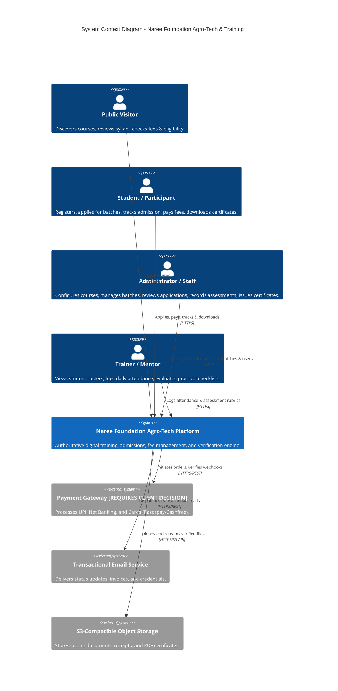
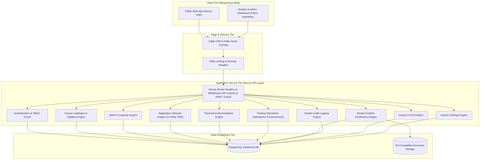
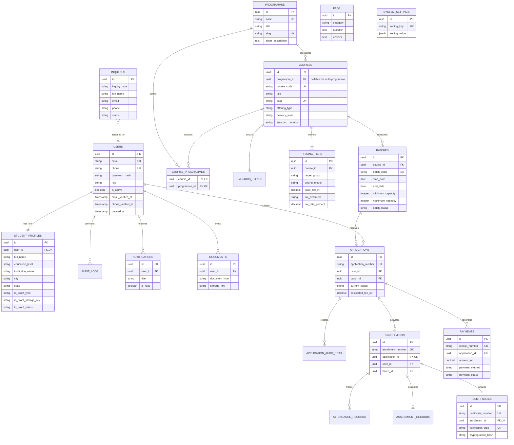

# SYSTEM ARCHITECTURE DOCUMENT
## Project: Naree Foundation Agro-Tech & Training Web Application
**Document Identifier:** DOC-02-ARCH  
**Version:** 1.2.0 (Documentation Reconciliation & Source Audit Baseline)  
**Status:** AUDITED ARCHITECTURE BASELINE / TECHNICAL SPECIFICATION (SOURCE VERIFICATION PENDING)  
**Author:** Senior Full-Stack Software Architect & Technical Lead  
**Date:** October 2026  
**Primary Brand:** Naree Foundation (Philosophy: *“Empower • Educate • Elevate”*) `[SOURCE-BACKED - LOGO ASSET VERIFIED; PRIMARY BROCHURE PENDING]`  

---

## 1. Architectural Classification & Stack Governance

All technology specifications in this document are governed by the project-wide classification standards:
- **`[SOURCE-BACKED]`**: Direct business drivers from verified primary documents.
- **`[TECHNICAL RECOMMENDATION]`**: Architectural designs formulated to meet business goals.
- **`[REQUIRES CLIENT DECISION]`**: External vendor or gateway integrations requiring client contracting.

### 1.1 Technology Evaluation & MVP Phasing Strategy `[TECHNICAL RECOMMENDATION]`
*(Verified compatibility baseline as of October 2026 against official stable release channels)*

| Architectural Layer | Recommended Technology | Concrete Version Strategy | Phasing Classification | Rationale & Alternatives |
| :--- | :--- | :--- | :--- | :--- |
| **Runtime Environment** | **Node.js** | `20.x LTS (Iron)` or `22.x LTS (Jod)` | **MVP REQUIRED** | Active Long Term Support runtime ensuring security patches, native fetch, and high stability. |
| **Frontend Framework** | **Next.js (App Router)** | `14.2.24+` (React `18.3.1`) | **MVP REQUIRED** | Server-side rendering for catalogue SEO; unified full-stack TypeScript API routes. Ultra-stable App Router baseline guaranteeing seamless compatibility with `@react-pdf/renderer` 3.4.x and Prisma 5.22.x without React 19 canary volatility. |
| **Language & Typings** | **TypeScript** | `5.4.x / 5.5.x` | **MVP REQUIRED** | Enforces compile-time type safety across business models, DTOs, and API responses. |
| **Styling & CSS** | **Tailwind CSS** | `3.4.x` | **MVP REQUIRED** | Stable utility framework enforcing canonical design tokens (`05_DESIGN.md`). Avoids early v4 syntax migration churn. |
| **Iconography** | **Lucide React** | `0.370.x+` | **MVP REQUIRED** | Lightweight, accessible SVG vector icons. Strictly enforces `RULE-UI-001` (zero emoji UI). |
| **Database ORM** | **Prisma ORM** | `5.22.x` | **MVP REQUIRED** | Declarative schema, automated migrations, type-safe queries, built-in SQL injection defense. |
| **Primary Relational DB**| **PostgreSQL** | `15.x / 16.x` | **MVP REQUIRED** | ACID-compliant relational storage for financial ledgers, audit logs, and normalized admissions data. |
| **Form & Payload Validation**| **Zod** | `3.23.x` | **MVP REQUIRED** | Strict runtime schema parsing for all incoming API payloads and forms. |
| **Document / Blob Storage** | **Cloudflare R2 / AWS S3** | S3-Compatible API | **MVP REQUIRED (Phase 4+)** | Secure private storage for student ID proofs, receipts, and generated PDF certificates. Signed temporary URLs. |
| **Payment Gateway** | **Razorpay API / Cashfree** | Official Node SDK | **REQUIRES CLIENT DECISION** | Essential for automated UPI, Net Banking, and Cards. Offline reconciliation is provided as MVP fallback. |
| **Transactional Email** | **Resend / SendGrid** | REST API SDK | **MVP REQUIRED (Phase 7)** | Transactional alerts for admissions and receipts. Can use SMTP / mock mailer during early local development. |
| **PDF Generation Engine**| **@react-pdf/renderer** | `3.4.x` | **MVP REQUIRED (Option A: Phase 6, 10 / Option B: Phase 6)** | Compiles serialized payment receipts and verifiable PDF completion certificates. |
| **Caching & Job Queue** | **Redis + BullMQ** | Redis `7.x` | **POST-MVP / FUTURE SCALE**| Deferred from Phase 1. Native Next.js cache and synchronous jobs are sufficient for initial low-concurrency MVP. |
| **SMS / WhatsApp Gateway**| **DLT Telecom Gateway** | REST API | **REQUIRES CLIENT DECISION** | Deferred to post-MVP or when DLT entity credentials are provided by client. |

---

## 2. System Context (C4 Level 1)



---

## 3. Logical Architecture & Component Model (C4 Level 2)



---

## 4. Relational Database Architecture

The persistence model enforces strict normalization, relational referential integrity, and complete audit logging.



### 4.1 SQL Schema Definitions (DDL) `[TECHNICAL RECOMMENDATION]`

```sql
-- 1. USERS & IDENTITY [ARCH-AUTH-001]
CREATE TABLE users (
    id UUID PRIMARY KEY DEFAULT gen_random_uuid(),
    email VARCHAR(255) UNIQUE,
    phone VARCHAR(20) UNIQUE,
    password_hash VARCHAR(255) NOT NULL,
    role VARCHAR(50) NOT NULL CHECK (role IN ('PUBLIC_VISITOR', 'STUDENT_LEARNER', 'STAFF_TRAINER', 'SYSTEM_ADMIN')),
    is_active BOOLEAN NOT NULL DEFAULT TRUE,
    email_verified_at TIMESTAMPTZ,
    phone_verified_at TIMESTAMPTZ,
    created_at TIMESTAMPTZ NOT NULL DEFAULT NOW(),
    updated_at TIMESTAMPTZ NOT NULL DEFAULT NOW()
);

-- 2. STUDENT PROFILES [ARCH-DB-002] (Data Minimization: Personal fields optional)
CREATE TABLE student_profiles (
    id UUID PRIMARY KEY DEFAULT gen_random_uuid(),
    user_id UUID UNIQUE NOT NULL REFERENCES users(id) ON DELETE CASCADE,
    full_name VARCHAR(255) NOT NULL,
    gender VARCHAR(20),                -- Optional
    date_of_birth DATE,                 -- Optional
    education_level VARCHAR(100),       -- Optional
    institution_name VARCHAR(255),      -- Optional
    guardian_name VARCHAR(255),         -- Optional (relevant for minors)
    guardian_contact VARCHAR(50),       -- Optional
    city VARCHAR(100) NOT NULL,
    state VARCHAR(100) NOT NULL DEFAULT 'Maharashtra',
    id_proof_type VARCHAR(50),
    id_proof_storage_key VARCHAR(255),  -- Secure S3/R2 private object key (NEVER a public URL)
    id_proof_status VARCHAR(50) NOT NULL DEFAULT 'NOT_SUBMITTED' CHECK (id_proof_status IN ('NOT_SUBMITTED', 'PENDING_VERIFICATION', 'VERIFIED', 'REJECTED')),
    id_proof_verified_at TIMESTAMPTZ,
    created_at TIMESTAMPTZ NOT NULL DEFAULT NOW(),
    updated_at TIMESTAMPTZ NOT NULL DEFAULT NOW()
);

-- 3. PROGRAMMES (5 Core Disciplines) [ARCH-CAT-001]
CREATE TABLE programmes (
    id UUID PRIMARY KEY DEFAULT gen_random_uuid(),
    code VARCHAR(50) UNIQUE NOT NULL, -- 'HYDROPONICS', 'AEROPONICS', 'MUSHROOM', 'AQUACULTURE', 'WOMEN_AGRI'
    title VARCHAR(255) NOT NULL,
    slug VARCHAR(255) UNIQUE NOT NULL,
    short_description TEXT NOT NULL,
    full_description TEXT NOT NULL,
    icon_name VARCHAR(50) NOT NULL,
    display_order INT NOT NULL DEFAULT 0,
    is_active BOOLEAN NOT NULL DEFAULT TRUE,
    created_at TIMESTAMPTZ NOT NULL DEFAULT NOW()
);

-- 4. COURSES & OFFERING TYPES [ARCH-CAT-002]
-- Accommodates single-topic, multi-discipline packages, crash courses, and institutional workshops
CREATE TABLE courses (
    id UUID PRIMARY KEY DEFAULT gen_random_uuid(),
    programme_id UUID REFERENCES programmes(id) ON DELETE RESTRICT, -- NULL for multi-programme packages
    course_code VARCHAR(50) UNIQUE NOT NULL,
    title VARCHAR(255) NOT NULL,
    slug VARCHAR(255) UNIQUE NOT NULL,
    summary TEXT NOT NULL,
    offering_type VARCHAR(50) NOT NULL CHECK (offering_type IN ('CRASH_COURSE', 'TOPIC_CERTIFICATE', 'COMPLETE_PACKAGE', 'INSTITUTIONAL_WORKSHOP')),
    delivery_level VARCHAR(50) NOT NULL CHECK (delivery_level IN ('LEVEL_1_FOUNDATION', 'LEVEL_2_SKILL_CERTIFICATE', 'LEVEL_3_ENTERPRISE_PACKAGE', 'INSTITUTIONAL_WORKSHOP')),
    standard_duration VARCHAR(100) NOT NULL,
    prerequisites TEXT,
    is_published BOOLEAN NOT NULL DEFAULT FALSE,
    created_at TIMESTAMPTZ NOT NULL DEFAULT NOW()
);

-- 4b. COURSE TO PROGRAMMES JUNCTION [ARCH-CAT-003]
-- Maps courses spanning multiple disciplines (e.g. 3-week Complete Package or 1-day Crash Course)
CREATE TABLE course_programmes (
    course_id UUID NOT NULL REFERENCES courses(id) ON DELETE CASCADE,
    programme_id UUID NOT NULL REFERENCES programmes(id) ON DELETE RESTRICT,
    PRIMARY KEY (course_id, programme_id)
);

-- 5. SYLLABUS TOPICS (Exact 9-point syllabus structure) [ARCH-CAT-002]
CREATE TABLE syllabus_topics (
    id UUID PRIMARY KEY DEFAULT gen_random_uuid(),
    course_id UUID NOT NULL REFERENCES courses(id) ON DELETE CASCADE,
    topic_order INT NOT NULL,
    title VARCHAR(255) NOT NULL,
    description TEXT,
    practical_activity TEXT,
    created_at TIMESTAMPTZ NOT NULL DEFAULT NOW()
);

-- 6. PRICING TIERS [ARCH-DB-006] [ARCH-FEE-001]
-- Accommodates individual student rates and flat institutional workshop rates
CREATE TABLE pricing_tiers (
    id UUID PRIMARY KEY DEFAULT gen_random_uuid(),
    course_id UUID NOT NULL REFERENCES courses(id) ON DELETE CASCADE,
    target_group VARCHAR(100) NOT NULL,
    pricing_model VARCHAR(50) NOT NULL DEFAULT 'PER_STUDENT' CHECK (pricing_model IN ('PER_STUDENT', 'PER_INSTITUTION_SESSION')),
    base_fee_inr DECIMAL(10, 2) NOT NULL,
    tax_treatment VARCHAR(50) NOT NULL DEFAULT 'INCLUSIVE_OR_EXEMPT_PENDING_TAX_ADVICE',
    tax_rate_percent DECIMAL(5, 2),
    eligibility_notes TEXT,
    is_active BOOLEAN NOT NULL DEFAULT TRUE,
    effective_from TIMESTAMPTZ NOT NULL DEFAULT NOW()
);

-- 7. BATCHES & SCHEDULING [ARCH-DB-007]
CREATE TABLE batches (
    id UUID PRIMARY KEY DEFAULT gen_random_uuid(),
    course_id UUID NOT NULL REFERENCES courses(id) ON DELETE RESTRICT,
    batch_code VARCHAR(100) UNIQUE NOT NULL,
    start_date DATE NOT NULL,
    end_date DATE NOT NULL,
    venue_type VARCHAR(50) NOT NULL,
    venue_address TEXT NOT NULL,
    minimum_capacity INT NOT NULL DEFAULT 5, -- [SOURCE-BACKED] Operational planning assumption
    maximum_capacity INT NOT NULL,          -- Configurable per batch based on venue/trainer safety
    batch_status VARCHAR(50) NOT NULL DEFAULT 'SCHEDULED',
    primary_trainer_id UUID REFERENCES users(id),
    created_at TIMESTAMPTZ NOT NULL DEFAULT NOW()
);

-- 8. APPLICATIONS (12 States Lifecycle) [ARCH-FSM-001]
CREATE TABLE applications (
    id UUID PRIMARY KEY DEFAULT gen_random_uuid(),
    application_number VARCHAR(100) UNIQUE NOT NULL,
    user_id UUID NOT NULL REFERENCES users(id) ON DELETE RESTRICT,
    batch_id UUID NOT NULL REFERENCES batches(id) ON DELETE RESTRICT,
    pricing_tier_id UUID NOT NULL REFERENCES pricing_tiers(id) ON DELETE RESTRICT,
    current_status VARCHAR(50) NOT NULL DEFAULT 'DRAFT' CHECK (current_status IN (
        'DRAFT', 'SUBMITTED', 'UNDER_REVIEW', 'ACTION_REQUIRED', 
        'APPROVED', 'PAYMENT_PENDING', 'PAYMENT_CONFIRMED', 
        'ENROLLED', 'WAITLISTED', 'REJECTED', 'CANCELLED', 'COMPLETED'
    )),
    calculated_fee_inr DECIMAL(10, 2) NOT NULL,
    seat_hold_expires_at TIMESTAMPTZ, -- [ARCH-FSM-002] Configurable timeout
    submitted_at TIMESTAMPTZ,
    created_at TIMESTAMPTZ NOT NULL DEFAULT NOW(),
    updated_at TIMESTAMPTZ NOT NULL DEFAULT NOW()
);

-- 9. APPLICATION AUDIT TRAIL [ARCH-DB-009]
CREATE TABLE application_audit_trail (
    id UUID PRIMARY KEY DEFAULT gen_random_uuid(),
    application_id UUID NOT NULL REFERENCES applications(id) ON DELETE CASCADE,
    previous_status VARCHAR(50),
    new_status VARCHAR(50) NOT NULL,
    changed_by_user_id UUID REFERENCES users(id),
    comments TEXT,
    created_at TIMESTAMPTZ NOT NULL DEFAULT NOW()
);

-- 10. ENROLLMENTS
CREATE TABLE enrollments (
    id UUID PRIMARY KEY DEFAULT gen_random_uuid(),
    enrollment_number VARCHAR(100) UNIQUE NOT NULL,
    application_id UUID UNIQUE NOT NULL REFERENCES applications(id) ON DELETE RESTRICT,
    user_id UUID NOT NULL REFERENCES users(id) ON DELETE RESTRICT,
    batch_id UUID NOT NULL REFERENCES batches(id) ON DELETE RESTRICT,
    enrollment_status VARCHAR(50) NOT NULL DEFAULT 'ACTIVE',
    enrolled_at TIMESTAMPTZ NOT NULL DEFAULT NOW()
);

-- 11. PAYMENTS [ARCH-DB-011] [ARCH-PAY-001] [ARCH-PAY-002]
CREATE TABLE payments (
    id UUID PRIMARY KEY DEFAULT gen_random_uuid(),
    receipt_number VARCHAR(100) UNIQUE NOT NULL,
    application_id UUID NOT NULL REFERENCES applications(id) ON DELETE RESTRICT,
    amount_inr DECIMAL(10, 2) NOT NULL,
    payment_method VARCHAR(50) NOT NULL,
    payment_status VARCHAR(50) NOT NULL,
    transaction_reference VARCHAR(255),
    reconciled_by_user_id UUID REFERENCES users(id),
    created_at TIMESTAMPTZ NOT NULL DEFAULT NOW()
);

-- 12. TRAINING OPERATIONS: ATTENDANCE [ARCH-DB-012]
CREATE TABLE attendance_records (
    id UUID PRIMARY KEY DEFAULT gen_random_uuid(),
    enrollment_id UUID NOT NULL REFERENCES enrollments(id) ON DELETE CASCADE,
    session_date DATE NOT NULL,
    is_present BOOLEAN NOT NULL DEFAULT TRUE,
    recorded_by_user_id UUID NOT NULL REFERENCES users(id),
    notes TEXT,
    created_at TIMESTAMPTZ NOT NULL DEFAULT NOW(),
    UNIQUE (enrollment_id, session_date)
);

-- 13. TRAINING OPERATIONS: ASSESSMENTS [ARCH-DB-013]
CREATE TABLE assessment_records (
    id UUID PRIMARY KEY DEFAULT gen_random_uuid(),
    enrollment_id UUID UNIQUE NOT NULL REFERENCES enrollments(id) ON DELETE CASCADE,
    knowledge_check_satisfactory BOOLEAN NOT NULL DEFAULT FALSE,
    practical_skills_satisfactory BOOLEAN NOT NULL DEFAULT FALSE,
    mini_project_satisfactory BOOLEAN NOT NULL DEFAULT FALSE,
    attendance_criteria_met BOOLEAN NOT NULL DEFAULT FALSE,
    overall_outcome VARCHAR(50) NOT NULL CHECK (overall_outcome IN ('PENDING', 'SATISFACTORY', 'EXEMPLARY', 'NEEDS_REASSESSMENT')),
    evaluator_user_id UUID NOT NULL REFERENCES users(id),
    evaluated_at TIMESTAMPTZ NOT NULL DEFAULT NOW()
);

-- 14. CERTIFICATES & VERIFICATION [ARCH-DB-014] [ARCH-CERT-001] [ARCH-CERT-002]
CREATE TABLE certificates (
    id UUID PRIMARY KEY DEFAULT gen_random_uuid(),
    certificate_number VARCHAR(100) UNIQUE NOT NULL,
    enrollment_id UUID UNIQUE NOT NULL REFERENCES enrollments(id) ON DELETE RESTRICT,
    verification_uuid UUID UNIQUE NOT NULL DEFAULT gen_random_uuid(),
    recipient_name VARCHAR(255) NOT NULL,
    course_title VARCHAR(255) NOT NULL,
    course_duration VARCHAR(100) NOT NULL,
    training_provider VARCHAR(255) NOT NULL DEFAULT 'Naree Foundation Agro-Tech & Training',
    assessment_basis TEXT NOT NULL,
    cryptographic_hash VARCHAR(255) NOT NULL,
    certificate_storage_key VARCHAR(255) NOT NULL,
    issued_by_user_id UUID NOT NULL REFERENCES users(id),
    issued_at TIMESTAMPTZ NOT NULL DEFAULT NOW()
);

-- 15. AUDIT LOGS [ARCH-ADM-003]
CREATE TABLE audit_logs (
    id UUID PRIMARY KEY DEFAULT gen_random_uuid(),
    user_id UUID REFERENCES users(id),
    action VARCHAR(100) NOT NULL,
    entity_name VARCHAR(100) NOT NULL,
    entity_id VARCHAR(100),
    old_state JSONB,
    new_state JSONB,
    created_at TIMESTAMPTZ NOT NULL DEFAULT NOW()
);

-- 16. INQUIRIES & WORKSHOP BRIEFS [ARCH-PUB-003] [ARCH-DB-015]
CREATE TABLE inquiries (
    id UUID PRIMARY KEY DEFAULT gen_random_uuid(),
    inquiry_type VARCHAR(50) NOT NULL CHECK (inquiry_type IN ('GENERAL_INQUIRY', 'INSTITUTIONAL_WORKSHOP', 'COURSE_ADMISSION')),
    full_name VARCHAR(255) NOT NULL,
    email VARCHAR(255) NOT NULL,
    phone VARCHAR(50),
    institution_name VARCHAR(255),
    target_group VARCHAR(100),
    estimated_students INT,
    message TEXT NOT NULL,
    status VARCHAR(50) NOT NULL DEFAULT 'NEW' CHECK (status IN ('NEW', 'IN_REVIEW', 'CONTACTED', 'RESOLVED', 'CLOSED')),
    assigned_to_user_id UUID REFERENCES users(id),
    created_at TIMESTAMPTZ NOT NULL DEFAULT NOW(),
    updated_at TIMESTAMPTZ NOT NULL DEFAULT NOW()
);

-- 17. FAQS KNOWLEDGEBASE [ARCH-DB-015]
CREATE TABLE faqs (
    id UUID PRIMARY KEY DEFAULT gen_random_uuid(),
    category VARCHAR(100) NOT NULL,
    question TEXT NOT NULL,
    answer TEXT NOT NULL,
    display_order INT NOT NULL DEFAULT 0,
    is_published BOOLEAN NOT NULL DEFAULT TRUE,
    created_at TIMESTAMPTZ NOT NULL DEFAULT NOW(),
    updated_at TIMESTAMPTZ NOT NULL DEFAULT NOW()
);

-- 18. DOCUMENTS & FILES [ARCH-DB-017]
CREATE TABLE documents (
    id UUID PRIMARY KEY DEFAULT gen_random_uuid(),
    user_id UUID NOT NULL REFERENCES users(id) ON DELETE CASCADE,
    document_type VARCHAR(50) NOT NULL CHECK (document_type IN ('STUDENT_ID_PROOF', 'PAYMENT_RECEIPT', 'CERTIFICATE_PDF', 'INSTITUTION_MOU')),
    storage_key VARCHAR(255) NOT NULL,
    file_name VARCHAR(255) NOT NULL,
    file_size_bytes INT NOT NULL,
    mime_type VARCHAR(100) NOT NULL,
    is_verified BOOLEAN NOT NULL DEFAULT FALSE,
    verified_by_user_id UUID REFERENCES users(id),
    created_at TIMESTAMPTZ NOT NULL DEFAULT NOW()
);

-- 19. NOTIFICATIONS [ARCH-NOT-001]
CREATE TABLE notifications (
    id UUID PRIMARY KEY DEFAULT gen_random_uuid(),
    user_id UUID NOT NULL REFERENCES users(id) ON DELETE CASCADE,
    title VARCHAR(255) NOT NULL,
    message TEXT NOT NULL,
    notification_type VARCHAR(50) NOT NULL CHECK (notification_type IN ('ADMISSION_UPDATE', 'PAYMENT_RECEIPT', 'BATCH_REMINDER', 'CERTIFICATE_ISSUED', 'SYSTEM_ALERT')),
    link_url TEXT,
    is_read BOOLEAN NOT NULL DEFAULT FALSE,
    read_at TIMESTAMPTZ,
    created_at TIMESTAMPTZ NOT NULL DEFAULT NOW()
);

-- 20. SYSTEM SETTINGS [ARCH-DB-016] [ARCH-ADM-002]
CREATE TABLE system_settings (
    id UUID PRIMARY KEY DEFAULT gen_random_uuid(),
    setting_key VARCHAR(100) UNIQUE NOT NULL,
    setting_value JSONB NOT NULL,
    description TEXT,
    updated_by_user_id UUID REFERENCES users(id),
    updated_at TIMESTAMPTZ NOT NULL DEFAULT NOW()
);
```

---

## 5. API Architecture & RESTful Endpoints `[TECHNICAL RECOMMENDATION]`

### 5.1 Response & Error Envelope Standard
```json
// Successful Response Envelope
{
  "success": true,
  "data": { ... },
  "meta": {
    "timestamp": "2026-10-17T14:30:00Z",
    "version": "v1",
    "pagination": { "page": 1, "limit": 20, "total_items": 45, "total_pages": 3 }
  }
}

// Error Response Envelope
{
  "success": false,
  "error": {
    "code": "BATCH_CAPACITY_EXCEEDED",
    "message": "The requested training batch has reached its configured venue capacity.",
    "request_id": "req-98f2b7d1"
  }
}
```

### 5.2 Comprehensive API Endpoints Matrix

The following matrix documents all API routes implemented across project phases. Phasing flags correspond to the Core MVP boundary options (Option A: Phases 1–10; Option B: Phases 1–8).

| Method | Endpoint Route | Auth Role | Payload Validation | Success Response | Expected Error Conditions | MVP Phase |
| :--- | :--- | :--- | :--- | :--- | :--- | :--- |
| `GET` | `/api/health` | Public | None | `{ status: "ok", timestamp }` | `500` Service unavailable | Phase 1 |
| `POST` | `/api/v1/inquiries` | Public | Zod `InquirySchema` | `201 Created` with inquiry ID | `400` Invalid fields, `429` Rate limit | Phase 2 |
| `GET` | `/api/v1/faqs` | Public | Query `category` | `200 OK` list of active FAQs | `500` Database error | Phase 2 |
| `GET` | `/api/v1/programmes` | Public | None | `200 OK` array of 5 programmes | `500` Database error | Phase 3 |
| `GET` | `/api/v1/courses` | Public | Query filters (prog, level) | `200 OK` filtered course array | `400` Invalid query | Phase 3 |
| `GET` | `/api/v1/courses/:slug` | Public | Param `slug` | `200 OK` course dossier + syllabus | `404` Course not found | Phase 3 |
| `GET` | `/api/v1/batches` | Public | Query `course_id`, `status` | `200 OK` scheduled batches | `400` Invalid query params | Phase 3 |
| `POST` | `/api/v1/auth/register` | Public | Zod `RegisterSchema` | `201 Created` user session cookie | `400` Bad payload, `409` User exists | Phase 4 |
| `POST` | `/api/v1/auth/login` | Public | Zod `LoginSchema` | `200 OK` user session cookie | `401` Invalid credentials, `429` Rate limit | Phase 4 |
| `POST` | `/api/v1/auth/logout` | Authenticated | None | `200 OK` session cookie cleared | `401` Unauthorized | Phase 4 |
| `GET` | `/api/v1/profile` | Student | Session token | `200 OK` learner profile dossier | `401` Unauthorized, `404` Not found | Phase 4 |
| `PATCH` | `/api/v1/profile` | Student | Zod `ProfileUpdateSchema` | `200 OK` updated profile | `400` Invalid data, `401` Unauthorized | Phase 4 |
| `POST` | `/api/v1/profile/upload-id` | Student | Multipart file (≤5MB PDF/IMG)| `201 Created` storage key metadata | `400` Invalid MIME/size, `401` Unauth | Phase 4 |
| `POST` | `/api/v1/applications` | Student | Zod `ApplicationCreateSchema`| `201 Created` application record | `400` Bad batch, `409` Duplicate active | Phase 5 |
| `GET` | `/api/v1/applications/my-applications`| Student | Session token | `200 OK` list of learner applications| `401` Unauthorized | Phase 5 |
| `GET` | `/api/v1/applications/:id` | Student/Admin| Param `id` | `200 OK` application status + audit | `401` Unauthorized, `404` Not found | Phase 5 |
| `PATCH` | `/api/v1/admin/applications/:id/status`| Admin | Zod `FsmTransitionSchema` | `200 OK` updated status + audit log | `400` Illegal transition, `403` Forbidden | Phase 5 |
| `GET` | `/api/v1/applications/:id/audit-trail` | Admin | Param `id` | `200 OK` application transition log | `403` Forbidden, `404` Not found | Phase 5 |
| `POST` | `/api/v1/payments/create-order` | Student | Zod `PaymentOrderSchema` | `200 OK` order token / gateway payload| `400` Invalid state, `409` Hold expired | Phase 6 |
| `POST` | `/api/v1/payments/webhook` | External Gw | HMAC signature header | `200 OK` payment confirmed & enrolled | `400` Bad payload, `401` Signature fail | Phase 6 |
| `POST` | `/api/v1/admin/payments/offline-reconcile`| Admin | Zod `OfflinePaymentSchema` | `200 OK` confirmed receipt & enrolled | `400` Bad amount, `403` Forbidden | Phase 6 |
| `GET` | `/api/v1/payments/:id/receipt-pdf` | Student/Admin| Param `id` | `200 OK` binary PDF stream | `401` Unauthorized, `404` Not found | Phase 6 |
| `GET` | `/api/v1/notifications` | Authenticated | Session token | `200 OK` user notification list | `401` Unauthorized | Phase 7 |
| `PATCH` | `/api/v1/notifications/:id/read` | Authenticated | Param `id` | `200 OK` notification marked read | `401` Unauthorized, `404` Not found | Phase 7 |
| `GET` | `/api/v1/admin/dashboard-stats` | Admin | Session token | `200 OK` KPI metrics summary | `403` Forbidden | Phase 8 |
| `GET` | `/api/v1/admin/settings` | Admin | Session token | `200 OK` dynamic system configs | `403` Forbidden | Phase 8 |
| `PATCH` | `/api/v1/admin/settings` | Admin | Zod `SettingsUpdateSchema` | `200 OK` updated setting & audit log | `400` Bad schema, `403` Forbidden | Phase 8 |
| `GET` | `/api/v1/trainer/batches/:id/roster` | Trainer/Admin| Param `batch_id` | `200 OK` enrolled student roster | `403` Forbidden, `404` Batch not found | Phase 9 (Opt A MVP / Opt B Post-MVP) |
| `POST` | `/api/v1/trainer/attendance/bulk-mark` | Trainer/Admin| Zod `AttendanceBulkSchema` | `200 OK` logged attendance count | `400` Date mismatch, `403` Forbidden | Phase 9 (Opt A MVP / Opt B Post-MVP) |
| `POST` | `/api/v1/trainer/assessments/evaluate` | Trainer/Admin| Zod `AssessmentRubricSchema` | `200 OK` evaluation outcome record | `400` Criteria missing, `403` Forbidden | Phase 10 (Opt A MVP / Opt B Post-MVP) |
| `POST` | `/api/v1/admin/certificates/batch-generate`| Admin | Zod `CertGenerateSchema` | `201 Created` generated cert records | `400` Prereqs unmet, `403` Forbidden | Phase 10 (Opt A MVP / Opt B Post-MVP) |
| `GET` | `/api/v1/verify-certificate/:uuid` | Public | Param `uuid` | `200 OK` verification status payload | `404` Certificate invalid or not found | Phase 10 (Opt A MVP / Opt B Post-MVP) |
| `GET` | `/api/v1/admin/audit-logs` | Admin | Query filters (entity, date) | `200 OK` paginated audit trail | `403` Forbidden | Phase 11 |
| `GET` | `/api/v1/admin/reports/roster-export/:id`| Admin | Param `id` (format: csv/xlsx)| `200 OK` export file stream | `403` Forbidden, `404` Batch not found | Phase 11 |

---

## 6. Tamper-Evident Certification Architecture `[TECHNICAL RECOMMENDATION]`

1. **Deterministic Unique Identifier (`ARCH-CERT-001`):** Every certificate is assigned a unique verification UUID (`gen_random_uuid()`).
2. **Cryptographic Integrity Hash (`ARCH-CERT-002`):** The server computes an immutable SHA-256 hash across recipient identity, course title, duration, completion date, and verification UUID.
3. **Machine-Readable QR Code (`ARCH-CERT-003`):** The PDF certificate embeds a vector QR code directing to `https://[domain]/verify-certificate/{uuid}`.
4. **Public Verification Page:** Scanning the QR code loads a public verification page confirming:
   - Recipient Name `[SOURCE-BACKED - UNVERIFIED PENDING PDF]`
   - Full Course Title `[SOURCE-BACKED - UNVERIFIED PENDING PDF]`
   - Training Duration `[SOURCE-BACKED - UNVERIFIED PENDING PDF]`
   - Training Provider: *Naree Foundation Agro-Tech & Training* `[SOURCE-BACKED - UNVERIFIED PENDING PDF]`
   - Assessment Basis Satisfied `[SOURCE-BACKED - UNVERIFIED PENDING PDF]`
   - Authenticity Status: Authentic & Valid `[TECHNICAL RECOMMENDATION]`
   - Non-Accreditation Notice: Transparently states this credential is a foundation training certificate, not a statutory or university degree `[SOURCE-BACKED - UNVERIFIED PENDING PDF]`.

---

## 7. Security, Privacy & Performance Controls

- **Security Hardening (`ARCH-AUTH-001`):** Parameterized SQL queries via Prisma ORM; strict Content Security Policy (CSP); rate limiting on auth endpoints (5 req/min); zero credit card storage on servers (`RULE-PAY-003`).
- **Privacy & DPDP Act 2023 (`ARCH-DB-002`):** Mandatory consent checkboxes during registration; minimal personal data collection; right to request profile erasure. Private object storage with signed download URLs for identity documents.
- **Performance Budget:** Core Web Vitals target: Mobile LCP < 2.0s, FID/INP < 100ms, CLS < 0.1 on standard 4G networks.
- **Medical & Nutrition Safety (`ARCH-MED-001`, `ARCH-MED-002`):** All agricultural and nutritional content components strictly enforce the prohibition of curative disease claims and display the mandatory educational disclaimer banner.
- **Administrative Governance (`ARCH-ADM-001`, `ARCH-ADM-002`, `ARCH-ADM-003`):** KPI dashboard, dynamic batch/course management, and immutable system audit logging.
